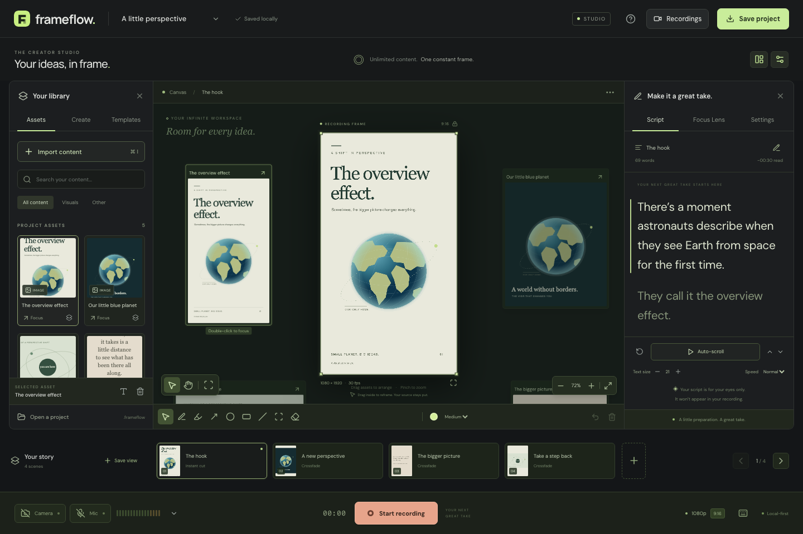

# Frameflow

**Unlimited content. One constant frame. One continuous recording.**

A local-first spatial studio for educational Reels, Shorts, and vertical video. Arrange source material on an infinite canvas, frame it independently, explain it with your camera and microphone, and record one continuous composition.

Frameflow is a browser recording studio built with React, TypeScript, Vite, Canvas 2D, Web Audio, MediaRecorder, and IndexedDB. No account, API key, or application server is required.



## Get started

Requires Node.js 22.13 or later and npm.

```bash
npm ci
npm run dev
```

Open the URL printed by Vite (normally `http://127.0.0.1:5173`). Camera and microphone access requires **localhost or HTTPS**. A plain HTTP address on your local network will not provide device access on iPad.

```bash
npm run check       # strict TypeScript
npm test            # coordinate, scene-isolation, and codec tests
npm run build       # production static site in dist/
npm run preview     # serve the production build locally
```

For browser tests:

```bash
npx playwright install chromium --only-shell
npm run test:production  # built app, repository subpath, enforced CSP
```

Optionally set `FRAMEFLOW_BROWSER_EXECUTABLE` to an installed Chromium-family executable. CI installs its own test browser. The tests use simulated camera and microphone devices; they never access your physical camera.

## Create a video

1. Import files, drag them onto the studio, or paste a screenshot. The example project gives you four scenes to try immediately.
2. Arrange assets anywhere on the canvas. Double-click an asset or select **Focus** to present it. Use **Focus Lens** to fit, fill, zoom, pan, change pages, and arrange output layers. Presentation transforms do not move the canvas source.
3. Enable the camera and microphone. Set presenter shape, size, position, border, mirroring, audio gains, media volume, and output resolution in **Settings**. The live meters show real input levels. Edit a selected audio/video asset to set its individual source volume, or play/pause it directly from the library.
4. Write a script in **Script**. Adjust its size and scrolling speed. Save the current view as another scene with **Save view**; scene framing, annotations, presenter placement, and script are preserved.
5. Select **Start recording**, check the output and devices, then start your take. Switch scenes and annotate without replacing the recording stream. Pause and resume as needed.
6. Finish to preview and download the video. Optionally trim a selected interval; trimming re-encodes in real time and preserves the original take.
7. Use **Save project** to download a `.frameflow` archive with all imported media. Open it from the project menu to continue on another device.

Project archives are limited to 512 MB expanded, with an 8 MB metadata limit; imports validate before saving into fresh media keys.

The studio autosaves the current project locally. Recordings and per-second recovery chunks are stored in IndexedDB. **Browser storage is not a backup**: clearing site data, changing origins, private browsing, or device storage pressure can remove it. Download project and video files you want to keep.

## Supported content

| Content                             | Import and presentation                                                                                |
| ----------------------------------- | ------------------------------------------------------------------------------------------------------ |
| PNG, JPEG, WebP, AVIF, screenshots  | Original local pixels, independent fit/fill/zoom/pan                                                   |
| SVG                                 | Plain, self-contained SVG; scripts, HTML and external references rejected                              |
| GIF                                 | Decoded animation frames; bounded decoding budget; use video for large animations                      |
| PDF                                 | PDF.js rendering with page navigation; save multiple views of the same document                        |
| Local video                         | Browser-decodable codecs, playback and audio through the shared mixer                                  |
| Local audio                         | Browser-decodable audio, independent playback and mixer volume                                         |
| Text and Markdown files             | Readable text assets; editable text, color, background and size                                        |
| PPTX                                | Slide text extraction; export a deck to PDF to retain its visual design                                |
| Webpages, articles and YouTube URLs | Safe reference cards. Paste article text or import a screenshot/PDF/local media to present the content |
| Direct media URLs                   | Fetched only when the source allows CORS; stored as local media                                        |
| Charts, diagrams, equations         | Import SVG/PNG/PDF, or use text and editable shapes                                                    |

File picker, drag and drop, clipboard image paste, URL import, and in-app text/shape creation are implemented. Add further file types through `ImportAdapter` in `src/lib/importers.ts`.

Embedded third-party players and arbitrary browser tabs do not expose a reliable, permitted video/audio source to this recorder. Frameflow does not extract protected video or bypass authentication/CORS. Link reference cards are clearly distinguished from captured page content.

## Recording behavior

- A dedicated **1080 × 1920** (or 720 × 1280) canvas is captured at a requested 30 fps. Actual delivered frame rate depends on device capacity.
- The microphone and permitted local media feed one Web Audio mix and one recording audio track. The microphone is never monitored through speakers. Media monitoring has a separate volume control.
- Scene changes update composition data. They do not recreate the captured stream or interrupt microphone input.
- The canvas includes presenter video, supported visual media, shapes, branding, and annotations. Editor panels, selection handles, and teleprompter are DOM-only and never captured.
- MP4 is chosen when the browser advertises an appropriate native encoder. Otherwise the download is **WebM with a `.webm` extension**. There is no bundled MP4 conversion service. Files are never renamed to pretend they use another format.
- Browser encoding failures, denied permissions, missing devices, media decoding failures, storage failures, and unsupported recording capabilities produce actionable messages.
- A backgrounded recording pauses deliberately. Resume from the studio when you return. Saved chunks can recover an interrupted take when the container supports partial playback; recovery is best effort.
- Camera blur/removal, automatic captions, arbitrary HTML capture, transitions beyond cuts/crossfades, and server-side transcoding are not included.

## Deploy

This is a static client-side app. Publish the contents of `dist/` on any HTTPS static host. No secrets or backend environment variables are needed. `base: './'` supports deployment beneath a repository path, including GitHub Pages.

The included GitHub Actions workflow audits dependencies, checks types, runs unit tests, and verifies the production build in the browser on pull requests and pushes to `main`. Action dependencies are pinned to verified commit SHAs. After enabling **Settings → Pages → Source: GitHub Actions**, successful pushes to `main` publish the exact tested build. Pull requests run the checks without deploying. A manual run is also available from Actions. See [deployment instructions](docs/DEPLOYMENT.md).

To publish local changes to this repository:

```bash
git add .
git commit -m "Build Frameflow recording studio"
git remote add origin https://github.com/jeetblahiri/frameflow.git
git push -u origin main
```

## Project structure

```text
src/
  components/       Studio panels, spatial canvas, presentation gestures and dialogs
  engine/           Dedicated composition, media rendering, audio graph, recorder and trim
  hooks/            Device lifecycle and studio engine integration
  lib/              Import adapters, example assets, IndexedDB persistence and backups
  model.ts          Versioned project schema and coordinate models
tests/
  unit/             Composition math, source/scene isolation, codec fallback
  e2e/              Production import, persistence, recording, recovery, responsive and security workflows
docs/
  ARCHITECTURE.md    Rendering, media ownership and persistence decisions
  VALIDATION.md     Acceptance coverage and real-device release checklist
```

## Device validation

Automated responsive tests are **not physical iPad certification**. See [docs/VALIDATION.md](docs/VALIDATION.md) for test evidence and the remaining hardware checks. Before recording important content, make a short take on your exact browser/device and play the downloaded file back. Long-session memory, background interruption, Bluetooth/device routing, Apple Pencil pressure behavior, and export reliability require validation on target hardware.

## Contributing

See [CONTRIBUTING.md](CONTRIBUTING.md). Licensed under [MIT](LICENSE). Fonts are bundled locally under their upstream OFL licenses; icons use Lucide’s ISC license. The example SVG illustrations are part of this project and make no external image requests.
